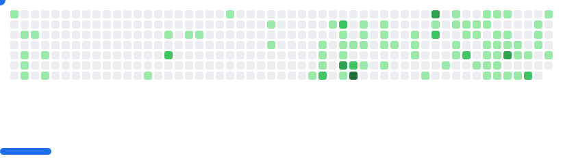

# Hi, I'm Tú Phan

I build Java backends in Hanoi.
My favorite question to ask about a feature is *what happens if this runs twice?*

[Portfolio](https://tus-portfolio.vercel.app/) · [Email](mailto:mudotet@gmail.com)

## Two backend problems I worked through

### [An order event arrives twice](https://github.com/mudotet/ecommerce-microservices)

In my Spring Boot e-commerce project, the order and inventory services use separate PostgreSQL databases and communicate through Kafka.
Inventory processing records the result by order ID so a redelivered event can't deduct stock twice.

### [A player retries a purchase](https://github.com/mudotet/mini-intern-server-project/tree/main/server)

In my Java game server demo, a player can retry a shop purchase with the same request ID and get the original receipt.
The API returns a conflict if the same ID comes back with different purchase details.

## A couple of things you can try

- [**GuideLens AI**](https://github.com/mudotet/GUIDELENS_AI) takes a screenshot and a question, then draws the suggested steps directly on the image.
- [**CivicPath AI**](https://ai-guided-public-service-procedures.vercel.app/) helps Vietnamese families work out which documents they need to register a birth. [Source](https://github.com/mudotet/AI-guided-public-service-procedures-Lonely-Stone-)

## Contribution Breakout

My GitHub contribution graph as a Breakout animation.

<picture>
  <source media="(prefers-color-scheme: dark)" srcset="./images/breakout-dark.svg" />
  <source media="(prefers-color-scheme: light)" srcset="./images/breakout-light.svg" />
  
</picture>
